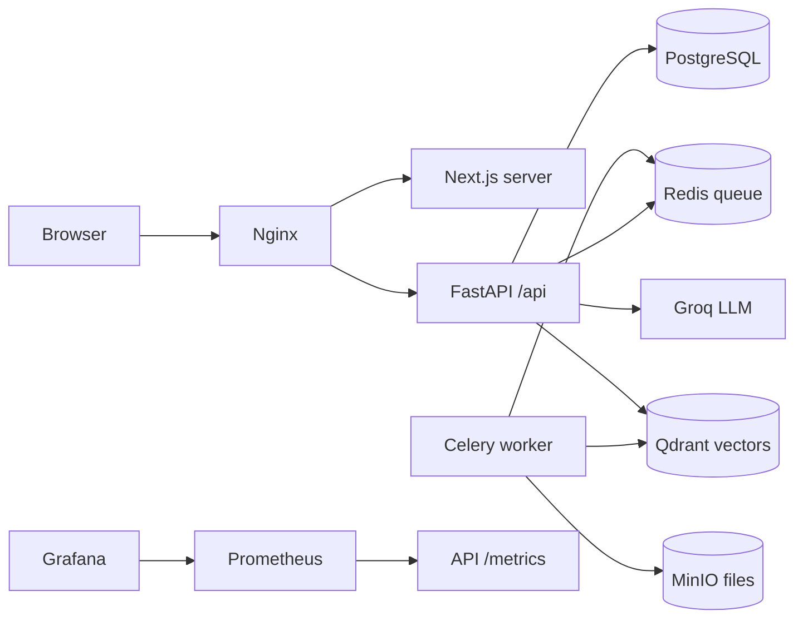

# KnowOps — company knowledge you can check

KnowOps lets teams upload internal documents and ask questions with citations to the source passages. Organizations, roles, groups and document permissions apply to both the library and search. The platform also finds conflicting/stale knowledge, keeps document versions, and turns answers into tasks or email drafts that require human approval.

The application is built with **Next.js/React, FastAPI, PostgreSQL and Alembic**. Celery/Redis process uploads, MinIO stores originals, Qdrant indexes passages, local fastembed models produce vectors, and a Groq-compatible LLM generates cited answers. Email drafts are stored; no email is sent automatically.



## Run the application

Requirements: Docker and Compose. For local development: Python 3.12+ and Node.js 22.

```bash
cp .env.example .env
# Edit .env: use different random SECRET_KEY/JWT_SECRET_KEY values and set LLM_API_KEY.
docker compose up --build -d
```

Open **http://localhost:3000**. Register, create an organization, upload a PDF/Word/Markdown/text/CSV document and ask a question. The first upload downloads the embedding model. Start the full Compose stack so the worker and reconciler are available.

- API health: http://localhost:8000/health
- Dependency readiness: http://localhost:8000/ready
- Prometheus metrics: http://localhost:8000/metrics
- API docs when `DEBUG=true`: http://localhost:8000/api/docs

The frontend uses a Node build stage and a non-root Nginx runtime. A separate non-root Next.js server preserves dynamic routes and server rendering. The API also runs as a non-root user. Persistent volumes hold data; `docker compose down` preserves them.

## REST API examples

All organization routes require a Bearer access token. Tenant membership and document access are checked server-side.

| Method | Endpoint | Purpose |
|---|---|---|
| GET | `/health` | Process health, no authentication |
| POST | `/api/v1/auth/register` | Register a user |
| POST | `/api/v1/auth/login` | Obtain access/refresh tokens |
| GET | `/api/v1/organizations/{org_id}/documents` | List visible documents |
| POST | `/api/v1/organizations/{org_id}/documents` | Upload a document |
| PUT | `/api/v1/organizations/{org_id}/documents/{doc_id}/access` | Set document restriction |
| DELETE | `/api/v1/organizations/{org_id}/documents/{doc_id}` | Archive a document |

Restricted documents stay restricted when their last grant is removed. Prior versions keep serving until a new version successfully indexes. Citation and action evidence is rechecked against current access. Scanned image-only PDFs require OCR before uploading.

## Tests and quality gates

```bash
# Containerized test environment: uses knowops_test, never the application database.
docker compose --profile test run --rm test

# Local tooling / CI equivalent:
cd backend
python -m pip install -r requirements-dev.txt
pytest -v
ruff check app tests
mypy app
cd ../frontend
npm ci
npm test
npm run lint
npx tsc --noEmit
npm run build
```

The suite covers authentication, tenant/document authorization, invitation expiry, concurrent owner changes, multilingual extraction/chunking, citations, task approvals, LLM resilience, upload recovery, worker loops and metrics. Most API tests fake external services. `backend/scripts/verify_live.py` additionally exercises the real stack using an isolated scratch database and cleans up its synthetic files/collections.

`requirements.txt` and `requirements-dev.txt` install dependencies defined in `pyproject.toml`. Pytest is configured in `backend/pytest.ini`. A temporary install-time `braces` nesting guard protects development lint tooling until an upstream fix is available; its regression tests run with `npm test`. Registry advisory metadata still reports that upstream version.

## DevOps capstone

The [submission guide](docs/CAPSTONE.md) maps all ten grading modules to files and evidence. The [operations guide](docs/OPERATIONS.md) covers local Kubernetes, AWS Mumbai, deployment identity, monitoring and teardown. [Security notes](docs/SECURITY.md) explain the Trivy gate and scan results.

- `.github/workflows/action.yml`: tests and quality checks **before image builds**, Trivy on backend/Nginx/Next images, GHCR commit-SHA publication, and opt-in EKS deployment with GitHub OIDC.
- `terraform/`: VPC, two public subnets, EKS worker group, EBS CSI, and scoped deployment identity. Credentials, state, plans and real variable files are excluded from Git.
- `k8s/` and `helm/knowops/`: bootstrap manifests and a complete chart with two backend/frontend replicas, internal Services, migration Job, data persistence and Ingress routing.
- `monitoring/`: Prometheus/Grafana Helm values, ServiceMonitor support and a provisioned application dashboard.
- `scripts/verify.sh`, `scripts/scan-images.sh`, `scripts/deploy-local.sh`: reproducible validation, scanning and local deployment.
- `evidence/`: executed check output and screenshots, with external submission gaps explicitly identified.

Real AWS resources cost money. Run the documented teardown after evaluation and keep the successful destroy output. A local mock Terraform plan does not replace real AWS plan/apply/destroy evidence.

Repository: https://github.com/tezivindh/knowops

Proprietary — all rights reserved.
